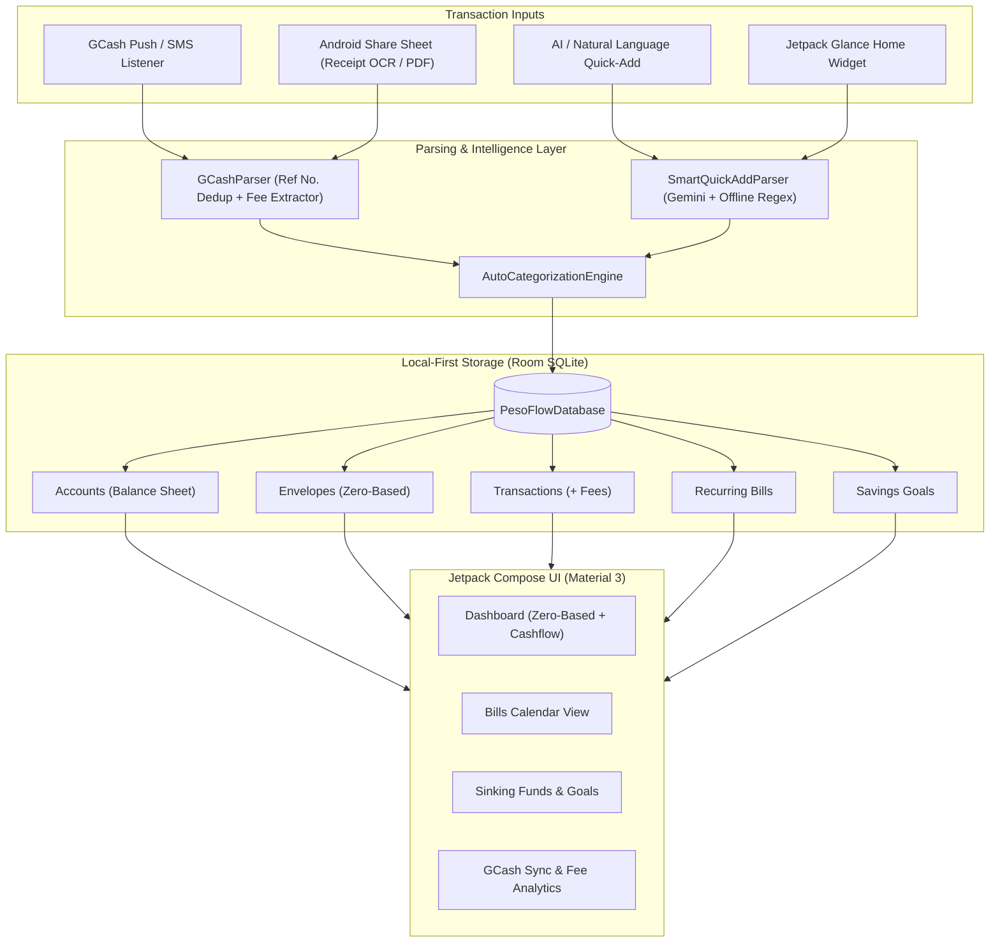

# PesoFlow — Hybrid Zero-Based & Cashflow Budgeting App for Android (GCash-First)

**PesoFlow** is a privacy-first, native Android budgeting application built with **Kotlin**, **Jetpack Compose (Material 3)**, and **Room SQLite**. It combines **Zero-Based Envelope Budgeting** ("Give every peso a job") with a **Simple Cashflow & Balance Sheet** overview, tailored for **GCash** users.

---

## ✨ Key Features

### 1. Hybrid Budgeting Engine (Zero-Based + Balance Sheet Cashflow)
- **Zero-Based Envelopes**: Track **Ready to Assign** funds and allocate money across monthly category envelopes (*Assigned*, *Activity*, and *Available* balances).
- **Cashflow & Balance Sheet View**: Live Net Worth calculation across **Assets** (GCash Wallet, Bank Accounts, Physical Cash, Savings) and **Liabilities** (Credit Cards, Loans, GLoan/GGives) alongside monthly **Income vs. Expense** cashflow metrics.

### 2. Automated GCash Sync (No Paid Bank API Needed)
Since GCash does not expose a public consumer API, PesoFlow integrates natively with Android in two ways:
- **Real-Time Notification & SMS Listener (`GCashNotificationListenerService`)**: Automatically detects push notifications from `com.globe.gcash.android` and GCash SMS alerts (Express Send, QR Pay, Bills Pay, Cash-In, Bank Transfer), extracts the **amount**, **recipient/merchant**, **GCash Reference Number**, and logs the transaction with automatic duplicate prevention.
- **Screenshot Receipt Share & PDF Statement Importer**: Share any GCash receipt screenshot directly from the GCash app to **PesoFlow** via the Android Share Sheet (powered by on-device ML Kit OCR), or import your GCash PDF transaction history e-statement.

### 3. GCash Transfer & Convenience Fee Tracker
- One-tap and auto-detected tracking for **₱15 InstaPay / Bank Transfer fees**, **1%–2% Cash-In fees**, and **Bills Payment convenience fees**.
- Dedicated monthly summary showing how much you've spent on transaction fees so you can optimize transfers.

### 4. Smart Auto-Categorization Rules
- Rule engine that matches merchant names or keywords (e.g., `Jollibee`, `Grab`, `Meralco`, `Netflix`, `7-Eleven`) to automatically assign the right budget envelope and default payment account.

### 5. AI Receipt Scanner & Natural Language Quick-Add
- Type or speak natural phrases like:
  - `"Spent 185 on iced coffee via GCash"`
  - `"Sent 2500 to landlord via GCash + 15 fee"`
- Supports **Gemini AI** structured parsing with an instant **offline local NLP regex fallback** for privacy and zero-latency offline use.

### 6. Recurring Bills Calendar & Sinking Funds
- **Bills & Subscriptions Calendar**: Visual monthly calendar highlighting bill due dates, subscription renewals, and paid/upcoming status.
- **Savings Goals / Sinking Funds**: Track emergency funds, travel, or gadget goals with visual progress bars, target dates, and required monthly contributions.

### 7. Android Home Screen Widget (Jetpack Glance)
- View your **GCash Wallet Balance**, **Ready to Assign** budget, and trigger a **1-Tap Quick Expense** or **AI Quick-Add** directly from your Android home screen.

---

## 🏗️ Architecture & Tech Stack



- **Language**: Kotlin 2.0
- **UI Framework**: Jetpack Compose (Material 3)
- **Local Database**: Room SQLite (`Flow`-backed reactive queries)
- **Home Screen Widget**: Jetpack Glance (`GlanceAppWidget`)
- **OCR & AI**: Google ML Kit Text Recognition (on-device receipt OCR) + Google AI Client SDK for Android (`generativeai`)

---

## 📂 Project Structure

```text
app/src/main/java/com/pesoflow/app/
├── data/
│   ├── local/
│   │   ├── dao/BudgetDao.kt                  # Reactive Room queries for ZBB, Cashflow & Deduplication
│   │   ├── entities/
│   │   │   ├── AccountEntity.kt              # Asset/Liability accounts (GCash, Bank, Cash, Credit)
│   │   │   ├── CategorizationRuleEntity.kt   # Keyword -> Envelope + default fee rules
│   │   │   ├── EnvelopeEntity.kt             # Zero-based budget envelopes
│   │   │   ├── RecurringBillEntity.kt        # Subscriptions & calendar bills
│   │   │   ├── SavingsGoalEntity.kt          # Sinking funds with visual progress
│   │   │   └── TransactionEntity.kt          # Transactions with convenience fee & GCash Ref No.
│   │   └── PesoFlowDatabase.kt               # Room database + default PH merchant rules seed
│   └── repository/BudgetRepository.kt        # Single source of truth coordinating DB & parsers
├── domain/
│   ├── AutoCategorizationEngine.kt           # Smart merchant-to-envelope rule matcher
│   └── SmartQuickAddParser.kt                # Natural language & Gemini AI quick-add parser
├── sync/
│   ├── GCashNotificationListenerService.kt   # Real-time Android NotificationListenerService for GCash
│   ├── GCashParser.kt                        # Regex extractor for GCash Express Send, QR, Bills, Fees
│   └── GCashStatementImporter.kt             # Receipt OCR & PDF statement parser
├── ui/
│   ├── components/QuickAddSheet.kt           # Fast manual + NL input bottom sheet with ₱15 fee toggle
│   ├── screens/
│   │   ├── BillsCalendarScreen.kt            # Monthly calendar grid & subscription tracker
│   │   ├── DashboardScreen.kt                # Zero-based Ready-to-Assign + Cashflow Balance Sheet
│   │   ├── GCashSyncScreen.kt                # GCash listener toggle, fee tracker, PDF/OCR import
│   │   └── SavingsGoalsScreen.kt             # Sinking funds & progress bar cards
│   ├── theme/Theme.kt                        # Material 3 Emerald & GCash Blue palette
│   └── viewmodel/BudgetViewModel.kt          # StateFlow UI state holder
├── widget/
│   └── PesoFlowGlanceWidget.kt               # Home screen widget for balance & 1-tap quick expense
├── MainActivity.kt                           # Main navigation host
└── ShareReceiptActivity.kt                   # Handles images/PDFs shared from the GCash app
```

---

## 🚀 Getting Started

### Prerequisites
- **Android Studio Ladybug (2024.2.1)** or newer
- **JDK 17+**
- **Android SDK 35** (Min SDK 26 / Android 8.0+)

### Setup & Run
1. Clone this repository:
   ```bash
   git clone https://github.com/<your-username>/pesoflow.git
   cd pesoflow
   ```
2. *(Optional)* To enable cloud Gemini AI receipt/natural-language parsing alongside the built-in offline parser, add your API key to `local.properties`:
   ```properties
   GEMINI_API_KEY=your_api_key_here
   ```
3. Open the project in **Android Studio** and run on an Android device or emulator.
4. To enable **Live GCash Auto-Sync**, go to the **GCash Sync** tab inside the app and tap **Grant Notification Access**.

---

## 🛡️ Privacy First
All financial data, GCash reference numbers, and account balances are stored **100% locally** in an on-device Room SQLite database. Notification parsing and receipt OCR run directly on your device.
